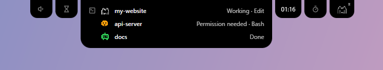

<div align="center">


# Minim Notch

**Open-core minimalist notch for Mac / PC / Linux**

[](https://github.com/QuentinBruyere/minim-notch/actions/workflows/ci.yml)
[](LICENSE)

[](https://tauri.app)
[](https://www.rust-lang.org)
[](https://svelte.dev)

<br />




</div>

## Why Minim Notch?

I was looking for a small notch on Windows to keep an eye on what was going on, and found nothing convincing. Existing tools took too much room, did not look the way I wanted, raised privacy concerns, and were often paid. So I built my own.

## What it is

Minim Notch is a small area, always on top, at the edge of your screen. It is:

- **Open core**: the core is free software, and its code is right here.
- **Local only**: it runs entirely on your machine. No account, no tracking.
- **Modular**: everything it shows comes from modules you can turn on and off, and you can build your own.

It was first designed to follow my Claude Code sessions and their states. Over time I added other modules I use every day, such as a volume control that replaces the one built into Windows.

Follow what comes next on the [roadmap](https://minim-notch.com/roadmap/).

> **Platform status**: Windows 11 and 10 today. macOS and Linux are planned.

## Features

- **Never in your way**: never steals the focus, clicks pass through outside its shape, hides when an app is in full screen (optional).
- **Anywhere**: on any edge of any screen, at any spot along that edge.
- **Notch or pill**: attached to the edge, or floating like an island.
- **Auto-hide**: the notch tucks into the edge when you do not use it and comes back on hover.
- **Pinned modules**: give a module its own mini-notch next to the main one.
- **Companions**: little pixel-art creatures that act out what is happening. You can draw and import your own.
- **Your style**: light or dark theme, custom color and opacity.
- **Five languages**: English, French, German, Spanish and Japanese.
- **Updates**: Minim Notch tells you when a new version is out and installs it when you click, never on its own.

## Modules

| Module | What it does |
|---|---|
| **Claude Code** | Every session live: working, waiting for a permission, waiting for your answer, done. The most urgent one first, with a sound when a session needs you. |
| **Date and time** | The time and the date, in the format you like. |
| **Stopwatch** | Start, pause and reset, right from the notch. |
| **Timer** | A countdown that rings when it is over. |
| **Volume** (Windows) | A slider and a mute button, shown for a moment when the volume changes. Optionally replaces the Windows volume pop-up: the volume keys then show in the notch only. |
| **Media** (Windows) | What is playing on the computer (music, video, podcast), from any app, with its cover, a progress bar and play / pause / next buttons. Optionally takes over the media keys from Windows, whose pop-up then stays hidden. |
| **Companion** | A companion that reacts to everything happening in the notch: music, a timer ringing, the time of day. |

### Official version

Alongside this free core, an official version with paid modules may exist. The core stays free, and for most uses it is all you need.

### How Claude Code stays local

From the settings, Minim Notch adds hooks to your Claude Code settings (`~/.claude/settings.json`). Claude Code then sends its events to a small server that Minim Notch runs on your own machine (`127.0.0.1`), protected by a token unique to your installation. Nothing goes through the internet. You can remove the hooks from the same place at any time.

## Download

**Windows 10 / 11**: open the [latest release](https://github.com/QuentinBruyere/minim-notch/releases/latest), download `Minim.Notch_<version>_x64-setup.exe` and run it. Minim Notch then tells you when a new version is out.

macOS and Linux are not supported yet.

Windows may warn about an unknown publisher (SmartScreen): the installer is not signed with a paid certificate yet. Click "More info", then "Run anyway".

## Build from source

Requirements: [Rust](https://rustup.rs/), [Node.js](https://nodejs.org/) and [pnpm](https://pnpm.io/), plus the [Tauri prerequisites](https://tauri.app/start/prerequisites/) for your OS.

```sh
pnpm install
pnpm tauri dev      # run with hot reload
pnpm tauri build    # build the installer (Windows: NSIS)
```

Checks run by the CI:

```sh
pnpm check                                          # front-end types
cd src-tauri
cargo fmt --check
cargo clippy --all-targets -- -D warnings
cargo test
```

### Project layout

- `src/`: front-end (Svelte 5 + TypeScript), display only.
- `src-tauri/src/`: backend (Rust, Tauri 2): notch window, placement, settings, and the module contract (`module.rs`).
- `src-tauri/src/modules/<module>/` and `src/modules/<module>/`: one folder per module, Rust side and settings side. Start here to write your own module.
- `locales/`: translations, one file per language.

## Privacy

Minim Notch only connects to the internet to check for updates (at startup, then once a day), a setting you can turn off. That check is a plain request for the latest version number: no identifier, no statistics. The log and crash reports stay on your computer; if you want, you can attach them yourself to an issue.

## Contributing

For now, I am the only one developing Minim Notch, so pull requests are not accepted. Issues, on the other hand, are very welcome: a bug, an idea for a feature, a translation to fix? [Open an issue](https://github.com/QuentinBruyere/minim-notch/issues). I read them all and work on them when I have time.

## A personal project

Minim Notch is a personal project, built on my free time. I do not commit to maintaining it over time. That is also why it is open source: whatever happens, the code stays available for anyone to pick up.

## License

Minim Notch's core is free software under the [GNU General Public License v3.0](LICENSE). In short:

- You can **use** it for any purpose, **study** and **modify** its code, and **share** it, modified or not, even commercially.
- If you **distribute** a modified version, or a program built on it, you must release it under the **same license**, with its **source code**, keep the original copyright notice and say what you changed.
- Using or modifying it for yourself, without distributing it, comes with no obligation.

This summary is not the license itself: the [full text](LICENSE) is what counts.

Copyright (C) 2026 [Quentin Bruyère](https://quentinbruyere.dev)

---

<sub>Minim Notch is an independent project, not affiliated with Anthropic. Claude and Claude Code are trademarks of Anthropic.</sub>
